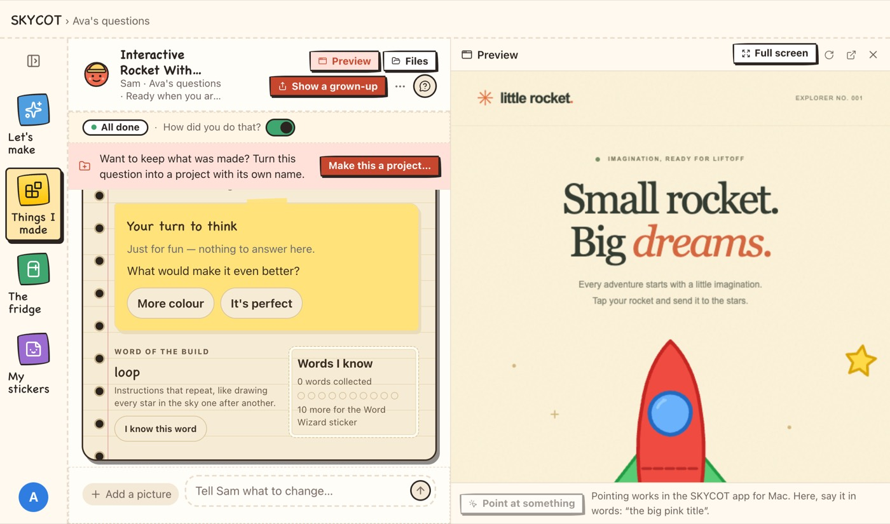
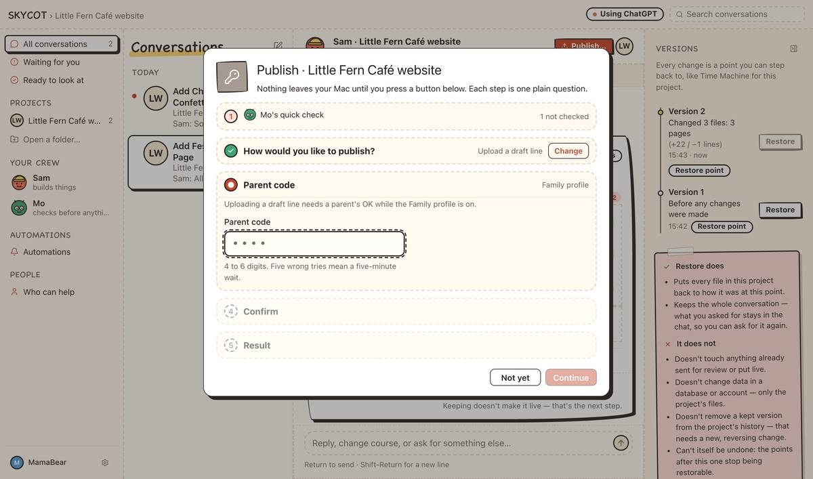
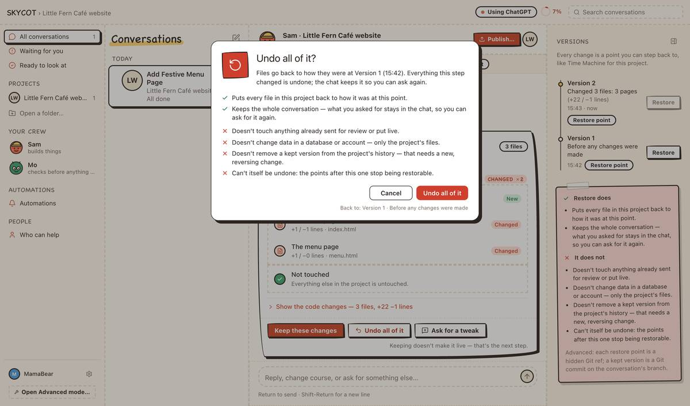

<!-- SKYCOT's front page. GitHub shows this file ahead of the root README.md, which stays upstream's
     (T3 Code's) README plus SKYCOT's attribution block, so upstream merges never conflict here.
     Links are relative to .github/, hence the "../". -->

# SKYCOT

**Do AI with your kids. Safely.**

SKYCOT is a free, open-source Mac app for a parent and a child to make things with AI together:
games, pages, cards, whatever they dream up. It runs on your Mac, with the AI account you already
pay for. A grown-up is always in the room, and nothing leaves the Mac without your code.

**[Download SKYCOT for Mac](https://skycot.com)** ·
[How the Family profile works](../docs/nondev/FAMILY.md) · [Discord](https://discord.gg/38gtBbywq6)



## The one rule

SKYCOT is for a child and an adult together. A child must not use SKYCOT on their own. The adult
stays present and supervising for the whole session, the way you would at a pool, and is
responsible for everything asked and made.

## How it works

- **Say it in plain words.** A child describes what they want to make. No code to read or write.
- **Plan first.** SKYCOT shows what it is about to do, in kid-sized words, before it touches
  anything. You both see it.
- **A grown-up's code for anything that leaves the Mac.** Putting work online needs the parent
  code. SKYCOT's engine on your Mac makes that check, not the AI.
- **Undo, always.** Every change is a point you can step back to, and Restore puts every file back.
- **Your Mac, your account.** What you make stays in a folder on your Mac. SKYCOT has no account of
  its own and doesn't resell AI: a grown-up signs in to ChatGPT (Codex), Claude, Google or another
  assistant through that service's own sign-in, so SKYCOT never sees the password.
- **Learning along the way.** A "word of the build", a "your turn to think" question and stickers
  turn each make into something a child understands, not only something they watched.

| The parent code                                                                                              | Undo                                                                         |
| ------------------------------------------------------------------------------------------------------------ | ---------------------------------------------------------------------------- |
|  |  |

## Straight answers

- **SKYCOT is guardrails, not a security product or a parental-control product.** You being there
  is the safety feature. The parent code is for the moment you step into the kitchen.
- **SKYCOT doesn't decide what an AI says.** The words come from the AI service you sign in to.
- **Each AI service sets its own age rules, and SKYCOT doesn't change them.** As of October 2026,
  Anthropic's Claude and Cursor require every user to be 18 or over, OpenAI's terms allow 13 to 17
  year olds with a parent's permission, and Google sets its own rules. SKYCOT runs signed in with a
  grown-up's own account; check your service's current terms first. In a Family profile, Codex and
  Claude are locked down for children, and any other AI waits for a grown-up's OK.

## Get it

Download from **[skycot.com](https://skycot.com)**. Free during the beta, Apple silicon (M1 or
later), macOS 13 or newer, signed and notarised by Apple, and it updates itself. You bring your own
AI account.

## What is in this repository

SKYCOT is built on [T3 Code](https://github.com/pingdotgg/t3code) by T3 Tools Inc. The engine, the
connectors to each AI service and the full developer interface are T3 Code's work. SKYCOT adds the
family side on top:

| Path                                                                                               | What it is                                                               |
| -------------------------------------------------------------------------------------------------- | ------------------------------------------------------------------------ |
| [`apps/nondev`](../apps/nondev)                                                                    | the SKYCOT interface: the workshop, the fridge, plans, the parent code   |
| [`apps/server/src/skycot`](../apps/server/src/skycot)                                              | the Family profile checks the engine enforces                            |
| [`packages/skycot-rules`](../packages/skycot-rules)                                                | the shared rules: what needs a grown-up, and when                        |
| [`apps/skycot-mobile`](../apps/skycot-mobile)                                                      | SKYCOT for iPhone and iPad                                               |
| [`packages/skycot-relay`](../packages/skycot-relay), [`infra/skycot-relay`](../infra/skycot-relay) | saying yes from your phone in the next room                              |
| [`nondev/`](../nondev)                                                                             | branding, scripts and the tools that keep this fork in step with T3 Code |

Every place SKYCOT touches one of T3 Code's own files is listed, with the reason, in
[`SEAM-MANIFEST.md`](../SEAM-MANIFEST.md). How the Family profile works is written up in
[`docs/nondev/FAMILY.md`](../docs/nondev/FAMILY.md).

## Build it yourself

You need a Mac, Node 24 and Vite+ (`vp`, the command runner this project uses).

```sh
curl -fsSL https://vite.plus | bash   # installs vp
vp i                                  # installs the packages
vp run dev                            # starts the engine and the interface
```

Open the address the last command prints. SKYCOT's interface is at `/simple/` on that address.
The full guide is [`docs/operations/development.md`](../docs/operations/development.md).

## Taking part

- **Found a problem or have an idea?** Open an issue in this repository, or say hello on
  [Discord](https://discord.gg/38gtBbywq6). Please report SKYCOT issues here, not to T3.
- **Found a security problem?** Report it privately: see [`SECURITY.md`](./SECURITY.md).
- **Want to send a change?** Open an issue first and tell us what you have in mind.

## Licence and credit

- The T3 Code parts are under the **MIT License** ([`LICENSE`](../LICENSE)), exactly as T3 Tools
  Inc. published them.
- SKYCOT's additions are © 2026 Curble Pty Ltd (trading as SKYCOT), under the **Apache License
  2.0** ([`LICENSE-APACHE`](../LICENSE-APACHE)).
- The SKYCOT name, logo, mascot and crew characters are not covered by either licence.

[`LICENSING.md`](../LICENSING.md) says which file is under which, and [`NOTICE`](../NOTICE) carries
the attributions.

"T3" and "T3 Code" are names of T3 Tools Inc. SKYCOT is an independent product and is not
affiliated with or endorsed by T3 Tools Inc. Claude, Codex, Cursor and Gemini are products of their
respective owners; SKYCOT is not affiliated with Anthropic, OpenAI, Anysphere or Google.
